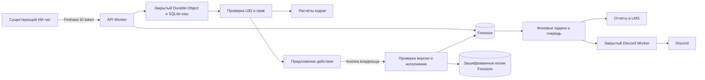

# Управление LMS через ИИ

Состояние на 18 ноября 2026: изменения подготовлены локально на основе `c888e9309a6479df32e0ffb8978674c5f04c39c8`. Для согласованного выпуска `20261118-ai2` включён переключатель `lms-config.js → enabled`. История учеников сохраняется.

Исходники обоих действующих Workers и действующие правила получены от владельца. Время отчётов подтверждено: ежедневно в 20:00, по воскресеньям в 20:05, Asia/Tashkent. Критерии «профи» и автоматическая выдача отдельно не подтверждены.

Рабочий адрес подтверждён: `https://msleaderindustry-hue.github.io/Test-LMS/`, публикация GitHub Pages. На сайте всего 10 учеников, посещают его в разное время. Серверный CORS уже соответствует этому адресу.

## Что было в проекте

Проверены все 26 исходных файлов, включая JavaScript внутри HTML-строк Word и TypeDrive. Отдельной серверной папки, конфигурации публикации Workers и правил Firestore в исходном репозитории не было.

| Файлы | Назначение и данные |
| --- | --- |
| `index.html`, `styles.css` | Загрузка React, Babel, Firebase, MathJax, модулей и оформления; конфигурация Firebase проекта `my-lms-project-13739` |
| `1_logic.js`, `2_ui.js` | Общие функции, состояния и элементы интерфейса |
| `3_auth_admin.js` | Google-вход, создание и загрузка `users/{uid}`, настройки доступа |
| `4_sidebar.js`, `7_app.js`, `8_landing.js` | Навигация, запуск модулей, главная страница; отложенная загрузка Excel/Word |
| `5_discord.js` | Старые клиентские уведомления через публичный Worker, журнал посещений и нарушения |
| `6_admin.js` | Ученики, настройки, выдача заданий, ответы на просьбы о помощи, прямые операции очистки |
| `9_stats_views.js` | Статистика профиля и история тестов, ранее также общая загрузка профилей для рейтинга |
| `10_chat.js` | Контакты, `private_chats/{chatId}/messages`, статусы прочтения и скрытие сообщений |
| `11_typing.js` | `users.typingProgress`, слабые клавиши и ограниченная история; внутри файла — игра TypeDrive, `typeDriveRooms`, `typeDrivePresence`, локальные рекорды |
| `12_hotkeys.js` | `users.hotkeyProgress`, результаты серий, ошибки, подсказки, история |
| `13_code_playground.js` | VS School, локальные черновики кода, изолированный предпросмотр, обращения к ИИ |
| `14_flashcards.js` | Наборы карточек и самооценка запоминания |
| `15_excel_trainer.js` | ИИ-генерация уроков, формулы, локальный вычислитель в Web Worker; `users.excelProgress` |
| `16_ai_chat.js` | Существующий плавающий ИИ-чат, история текущего диалога, обращение к преподавателю |
| `17_tests_module.js` | Вопросы, ответы, время и результаты; `users.testHistory`, локальные наборы и история тестов |
| `18_chess_module.js` | Партии, ходы, часы и результаты в `chessRooms` |
| `19_tasks.js` | `lmsAssignments/{id}`, `lmsAssignments/{id}/progress/{uid}`, запуск задания в тренажёре |
| `20_word.js` | Встроенный редактор и 19 упражнений; `users/{uid}/wordDocuments`, `wordResults`, проверка структуры документа |
| `activity_tracker.js` | `users/{uid}/activity`, присутствие и переходы |
| `error_tracker.js`, `error_journal.js` | Диагностики `platformErrors`, журнал владельца |
| `README.md` | Старая инструкция описывала отсутствующие `app.js` и `style.css`; заменена актуальной |

ИИ уже вызывался через `gemini-proxy-lms.msleaderindustry.workers.dev`. Discord — через `discordwebhook.msleaderindustry.workers.dev`. Секреты в присланных Workers находились в `env`, но сами публичные обработчики принимали запросы без проверки пользователя и разрешали любой Origin. Присланные общие правила разрешали любому вошедшему пользователю чтение и запись большинства коллекций и чужих профилей; отдельные ограничения Word/шахмат не закрывали остальные данные.

Подтверждены Workers Free и Firebase Spark. Сводки активности собираются примерно раз в 5 минут. Подробности бесплатной схемы: [FREE_PLAN.md](FREE_PLAN.md).

Для выпуска подготовлены серверная учётная запись Firestore с минимальной ролью, пять готовых индексов и две пустые очереди. Зашифрованный снимок базы до перехода содержит 526 документов и проверен расшифровкой. Вход GitHub через Git Credential Manager подтверждён. При выпуске правила, Workers и клиент переключаются вместе; исходные результаты учеников не очищаются.

## Как устроены изменения

Владелец определяется проверенным UID `1qhlWSbqAxd1dAvo2Nw92gdJhNk1`, а не полем `role` из профиля и не текстом модели. Браузер получает только авторизованный API. Разрешённые действия модели перечислены явно; команды подтверждения среди них нет.

Правила Firestore отдельно закрывают прямой доступ к чужим профилям, назначениям, результатам, приватным чатам и служебным коллекциям. В каталоге контактов ученик получает только необходимые для разрешённой переписки имена и идентификаторы. Собственные результаты Word/Excel записывает сервер. Черновики Word остаются доступны их автору. Сервер использует отдельную сервисную учётную запись: поскольку такой доступ обходит клиентские правила, проверка прав также выполняется в каждом API-маршруте. См. [модель доступа Firestore](https://firebase.google.com/docs/firestore/security/insecure-rules).

## Новые данные

| Путь | Содержимое |
| --- | --- |
| `lmsAttempts/{uid}:{attemptId}` | Единая история попыток, исходные счётчики, модуль/навык/язык, время, признак серверной проверки |
| `lmsEvents/{uid}:{eventId}` | Сгруппированные наблюдения и вычисленные результаты; без текста нажатий и буфера обмена |
| `lmsVersions/{uid}`, `lmsSnapshots/*` | Версии данных и краткосрочный кэш анализа; повторные запросы одного периода обновляют кэш |
| `lmsPlans/{uid}`, `lmsPlannerSlots/*` | Личный план и защита от повторных ежедневных предложений |
| `lmsProposals/{id}`, `lmsAudit/*` | Предложения, параметры подтверждения, статус и журнал исполненных действий |
| `lmsSettings/control` | Дата начала пилота, автоматическая выдача, подтверждённые критерии, включение отчётов |
| `lmsSettings/eventCursor` | Последний подготовленный интервал уведомлений |
| `lmsJobs/{id}` | Фоновые задачи, попытки, задержки, подтверждённые части отправки, ошибки |
| `lmsReports/{id}/students/{uid}` | Снимок отчёта по каждому ученику; общие итоги в родительском документе |
| `users/{uid}/assignments/{id}` | Представление задания только для этого ученика |
| `lmsReceipts/*`, `lmsMaterials/*`, `lmsLimits/*` | Защита от повторного зачёта, проверяемые материалы Excel и ограничения частоты |
| `lmsBackups/{id}/chunks/*` | Полные зашифрованные копии очисток; ключ только в серверном секрете, публичного доступа нет |
| SQLite `lms_ledger_cache` | Серверный кэш попыток и событий; исходные данные остаются в Firestore |

Старые профили и результаты сохраняются. Датированные истории тестов, печати и сочетаний участвуют в анализе с пометкой старого наблюдения. Они объединяются с новой историей без удвоения попыток. Недатированные суммы показываются как ранее накопленные данные, но не превращаются в выдуманную динамику. Старые локальные тесты без UID автоматически не приписываются текущему пользователю.

## Расчёты и личный план

Проценты рассчитываются по сумме правильных ответов и общему количеству, а не средним из процентов. Скорость приводится к знакам в минуту; WPM = CPM / 5. Точность печати учитывает введённые символы и ошибки. Повтор одного идентификатора попытки не увеличивает результат. Попытка тренажёра и зачёт этой же попытки в задании объединяются.

Динамика сравнивает равные периоды по одному модулю, навыку, языку, режиму и сложности. Для вывода нужны как минимум три отдельные попытки и десять ответов. Медиана группы появляется только при заданной группе и достаточных сопоставимых данных минимум трёх других учеников. Отсутствие данных обозначается явно, без нулевых оценок. Активное время объединяет пересекающиеся интервалы нескольких вкладок, исключает бездействие и ограничивает каждый интервал.

Рекомендация содержит рассчитанное основание: повторение слабой темы, закрепление или переход к более сложной работе. Фоновый план обновляется после новых результатов и по расписанию. Он предлагает задания в существующих модулях назначений: печать, сочетания, Word, Excel. Для печати учитываются слабые клавиши, для Excel — конкретная функция; более сильным ученикам предлагаются более длинные тексты, строгая серия сочетаний или следующая функция. Тесты, карточки, код и игры участвуют в наблюдении и рекомендациях; новый серверный банк оцениваемых тестов или автопроверка произвольного программного кода в этот выпуск не входят.

Пока есть невыполненное задание или ожидающее подтверждения предложение, новое автоматически не добавляется. Планировщик ограничен одним предложением в сутки на ученика. Первые 14 суток отсчитываются от подтверждения команды начала пилота. На 15-е сутки автоматическая выдача сама не включается: нужна отдельная команда владельца и подтверждение карточки. Очистка при этом всегда требует отдельного подтверждения.

Word проверяется на сервере по структуре переданного документа, Excel — вычислителем на серверном материале. Скорость печати, результаты локальных тестов, сочетаний и игр являются наблюдениями клиента; они не выдаются за доказательство отсутствия подсказок или подмены браузера. Для экзамена с защитой от подделки ответов нужен отдельный серверный банк вопросов. Самооценка карточек и запуск кода не превращаются в проверенные учебные баллы.

## Предложение критериев «профи» — ещё не применяется

Окно: последние 30 суток, только результаты после подтверждения критериев. Обязательные направления можно изменить до подтверждения.

| Направление | Предлагаемый порог |
| --- | --- |
| Печать | 250 знаков/мин, точность 98%, минимум 3 попытки от 3 минут в 3 разные даты |
| Тесты | 90% в сумме, минимум 3 прохождения; в каждой проверенной теме от 10 ответов и 85% |
| Сочетания клавиш | 95% решённых вопросов без подсказок, минимум 3 серии |
| Word | Серверная проверка всех условий упражнений `memo`, `report`, `table` |
| Excel | 90%, минимум 10 серверных проверок без подсказок и 5 разных успешно решённых функций |

Доля прогресса до «профи» — доля выполненных обязательных направлений, а не среднее баллов несовместимых предметов. До подтверждения выводится «Критерии ещё не утверждены».

## Отчёты и Discord

- Ежедневный отчёт: период 20:00 предыдущего дня — 20:00 текущего дня, отправка после закрытия периода.
- Недельный: воскресенье 20:00 — следующее воскресенье 20:00, отправка в 20:05.
- Неделя сверяется с семью суточными интервалами и сохранёнными ежедневными отчётами. Отдельно видны отсутствующая сводка и результаты, пришедшие после её расчёта.
- По команде доступны скользящие последние сутки/семь суток на текущий момент; они не выдаются за совпадающий по границам плановый отчёт.
- Подробности сохраняются в LMS до попытки доставки. Ошибка Discord не прячет сохранённый отчёт.

Cron работает каждую минуту и ставит задачи в очередь. UTC-границы соответствуют времени Ташкента; сами Cron Triggers Cloudflare используют UTC ([документация](https://developers.cloudflare.com/workers/configuration/cron-triggers/)).

События входа, переходов, печати, скрытия вкладки, потери фокуса, бездействия и завершения отправляются пачками до 30. Локальная очередь IndexedDB разделена по UID и переживает перезагрузку. Она ограничена 300 событиями и 23 часами; при переполнении или недоступности хранилища показывается уведомление. Сервер объединяет события примерно по минутным интервалам; каждое нажатие не отправляется. Видимость и фокус показывают состояние LMS, а не название чужой вкладки или окна.

Discord Worker закрыт от браузерных запросов. Сообщения ограничены по длине, упоминания отключены, ответ 429 учитывает `retry_after`. Подтверждённые части сохраняются; неудачные задачи можно повторить. Если Discord принял сообщение, но ответ потерян в сети, повтор может дать дубликат: абсолютная однократность для внешнего вебхука не обещается.

## Очистка и восстановление

Команда сначала собирает точный перечень документов/полей и число записей. Полная копия шифруется AES-256-GCM, сохраняется в закрытой коллекции Firestore, читается обратно, расшифровывается и проверяется SHA-256. Только затем появляется карточка подтверждения с неизменяемым идентификатором и контрольной суммой.

Кнопка работает только для владельца и актуального предложения. При изменении данных после предпросмотра операция целиком останавливается. Удаление и журнал записываются атомарно; повтор нажатия не повторяет удаление. Предложение очистки действует 30 минут. Восстановление также требует отдельной карточки и не затирает новые результаты. Команда «Копии» открывает завершённые очистки после закрытия/очистки истории ИИ-чата. Автоматического удаления копий, диагностик, отчётов и истории нет.

## Команды существующего чата

Примеры для владельца: «Проанализируй ученика …», «Подготовь задания …», «Начни 14-дневный пилот», «Включи ежедневные и недельные отчёты», «Сделай недельный отчёт сейчас», «Создай группу …», «Предложи очистить диагностики …». Действия изменяют данные только после карточки подтверждения, кроме отдельно включённого режима автоматических учебных назначений.

Короткие команды «Предложения», «Отчёты», «Копии», «Ошибки отправки», «Критерии профи» открывают соответствующие карточки без необходимости угадывать запрос модели. Ученический чат объясняет собственные результаты, не получает административных инструментов и не подтверждает действия.

## Проверка и границы выпуска

Пройдена 51 проверка серверной логики, 7 проверок правил в настоящем эмуляторе Firestore, 6 браузерных сценариев и комплексная проверка API/SQLite/очереди/Excel в workerd. Проверены арифметика, периоды, права, повторные записи, пилот, Word/Excel, конфликты очистки, копии/восстановление, очередь/429, сохранение событий после перезагрузки и отображение отчёта при отказе Discord. Проверка workerd также использует настоящий сетевой транспорт Firestore; отдельно проверено экранирование идентификаторов с двоеточием в REST. В проверенных браузерных сценариях необработанных ошибок и ошибок консоли нет. Автоматические тесты не используют производственные секреты и не отправляют реальные сообщения. Синтаксическая проверка клиента/встроенных скриптов и сборка обоих Workers через `--dry-run` проходят.

Дополнительно выполнен `pnpm bench:local`: синтетическая история за 30 дней, по 20 попыток в день и по 2 часа наблюдаемой активности в каждый день отчётной недели. Первоначальная проверка выявила общий лимит группового чтения: отчёты на 30/60 тестовых учеников останавливались. Исправлено: подробная история обрабатывается по ученикам, одновременно не больше двух; для общих итогов сохраняются компактные счётчики. Сравнения с группой и недельная сверка проверены отдельно.

| Тестовых учеников | Попыток за 30 суток | Событий за неделю | Недельный отчёт локально | Результат |
| --- | --- | --- | --- | --- |
| 10 | 6 000 | 16 800 | 318 мс | Все данные учтены |
| 30 | 18 000 | 50 400 | 1 685 мс | Все данные учтены |
| 60 | 36 000 | 100 800 | 6 358 мс | Все данные учтены |

В каждом сценарии также принят одновременный поток по 30 событий от каждого ученика. Результаты относятся к локальному Node.js и синтетическому хранилищу в памяти: они не измеряют сетевые задержки Firebase, лимиты конкретного тарифа Cloudflare или время ответа Gemini. Рабочая база и Discord в тесте не использовались. Для фактических 10 учеников перед включением остаётся проверка владельца/ученика и объёма существующей истории в тестовом окружении.

Ограничения чтения: 500 профилей, 4 000 попыток и 5 000 событий на ученика за запрошенное окно, 100 000 компактных попыток в итогах одного отчёта, 200 назначений на ученика. Превышение возвращает ошибку вместо неполного отчёта. Число 500 является ограничением выборки, а не заявленной вместимостью сервиса. Для больших объёмов отдельного ученика нужны страницы чтения или суточные агрегаты.

Одна очистка ограничена 180 документами и копией 4 МБ; очистка одного задания допускает до 201 связанного документа для 100 учеников. Если выборка больше, она не удаляется частично. Сохранение очень длинной прежней истории в поле профиля также ограничено размером документа Firestore; переход к отдельной коллекции не уничтожает старые данные автоматически.

Порядок публикации, секреты и проверка отката: [DEPLOYMENT.md](DEPLOYMENT.md).
